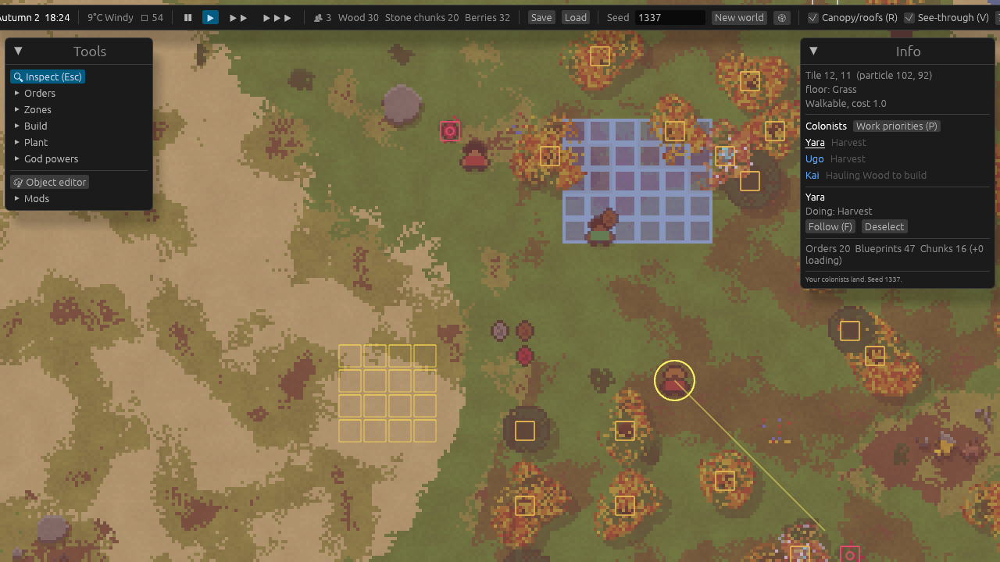
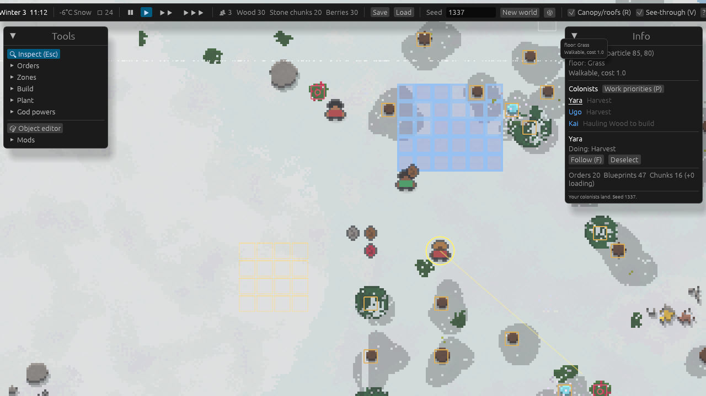
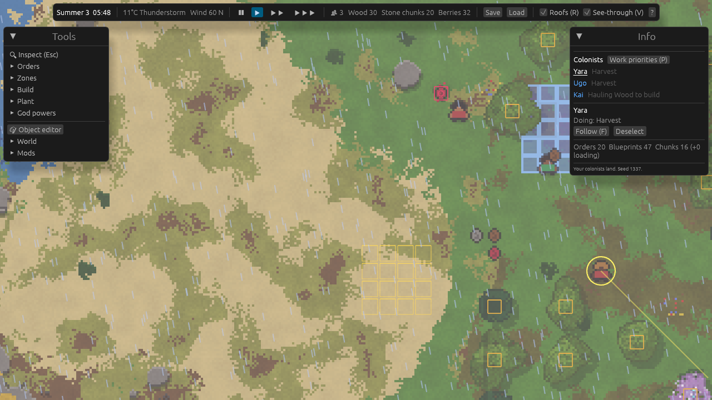
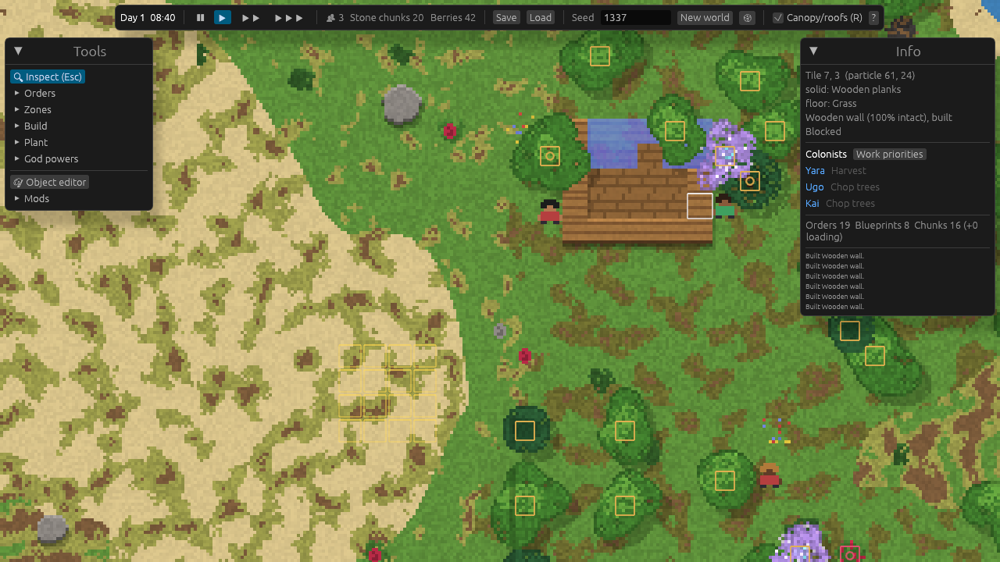
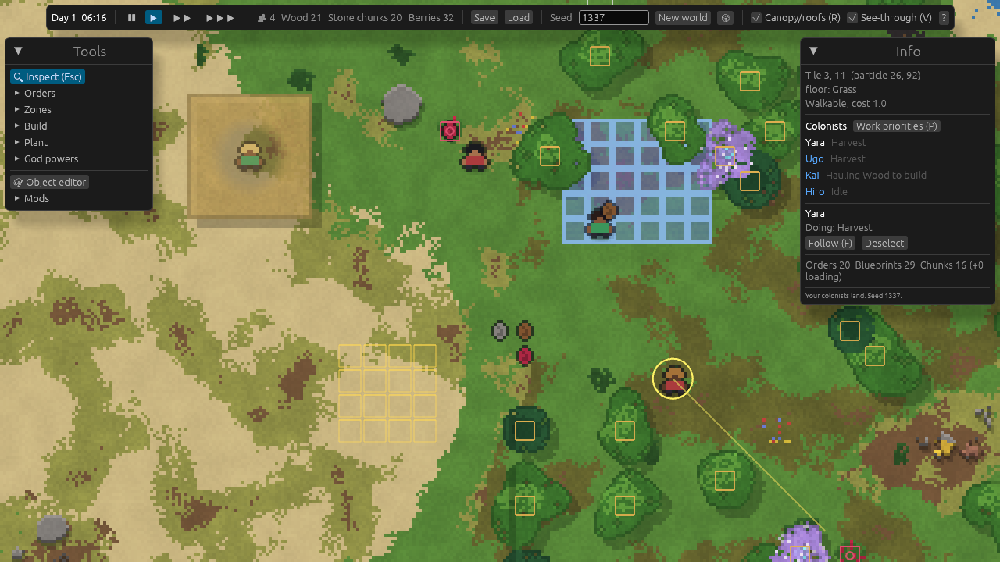
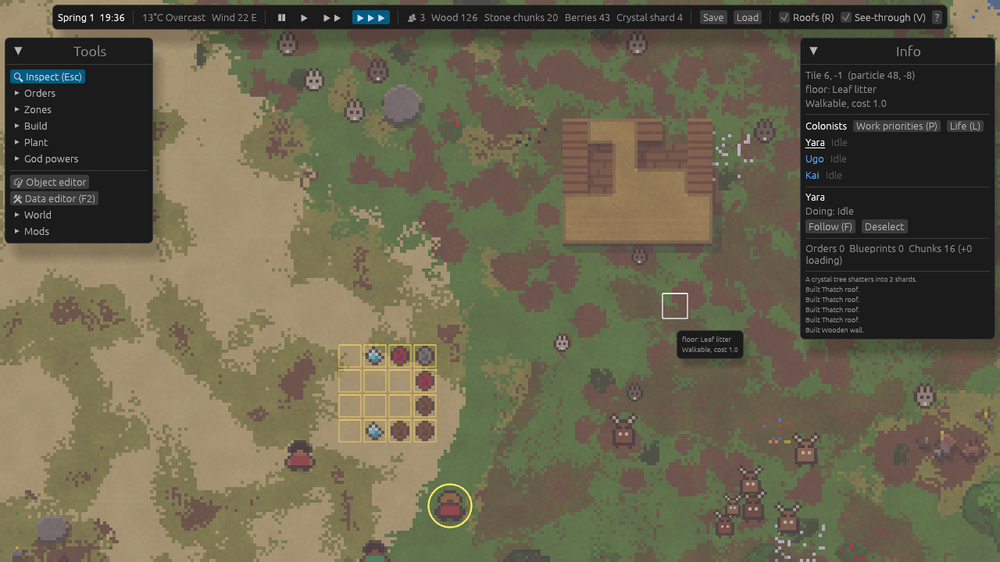
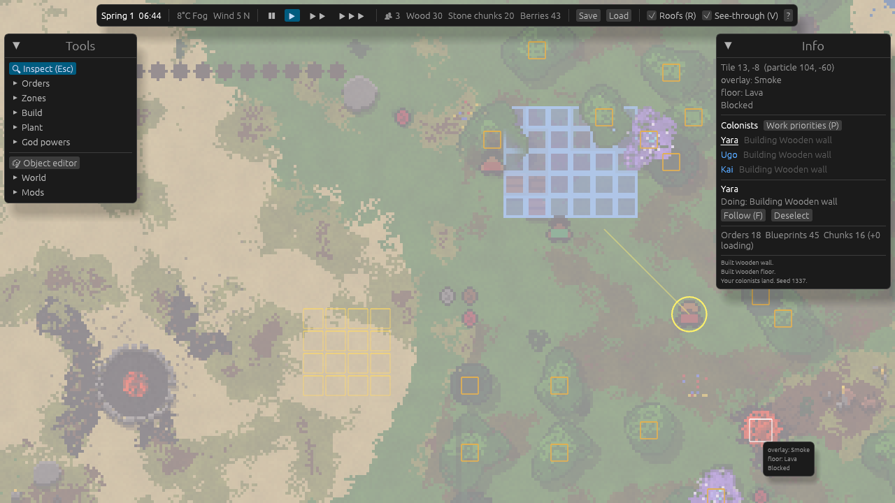
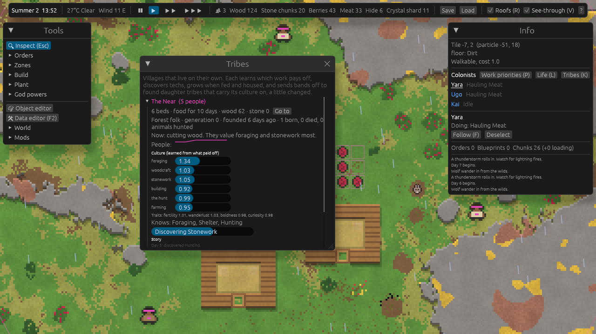

# Partiworld

**A top-down colony sim where the whole world is made of particles.**

Every tree, rock, wall, roof and patch of grass is a group of tiny particles. You can chop a tree and watch it wear away bit by bit, mine a hillside cell by cell, or set a dry meadow alight and watch the wind carry the fire. You play it like RimWorld: mark the work, plan the buildings, and your colonists get on with it. You can also play it like WorldBox: drop meteors, pour lava, flood valleys, release animals that breed, learn and evolve into new species, and watch tribes settle the land, learn, invent and spread. The world is generated from a seed, it goes on forever, and it changes with the seasons.

Built in Rust with [Bevy](https://bevyengine.org/). Everything is moddable with data files and [Rhai](https://rhai.rs/) scripts.



<table>
  <tr>
    <td></td>
    <td></td>
  </tr>
  <tr>
    <td align="center"><sub>Winter: snow cover, bare oaks, green pines</sub></td>
    <td align="center"><sub>A thunderstorm rolling in at dawn</sub></td>
  </tr>
  <tr>
    <td></td>
    <td></td>
  </tr>
  <tr>
    <td align="center"><sub>Colonists hauling wood and raising walls</sub></td>
    <td align="center"><sub>Roofs fade so you can see who's inside</sub></td>
  </tr>
  <tr>
    <td></td>
    <td></td>
  </tr>
  <tr>
    <td align="center"><sub>Rabbits and deer grazing round patches into the meadow</sub></td>
    <td align="center"><sub>A meteor crater with a molten core, and poured lava</sub></td>
  </tr>
</table>


<p align="center"><sub>A tribe's village. The Tribes window (K) shows what it values, what it knows and its story.</sub></p>

## Play

You need the latest stable [Rust](https://rustup.rs/). Then:

```bash
git clone https://github.com/Fanaperana/partiworld
cd partiworld
cargo run --release -- 1337
```

The number is the world seed; leave it out for the default world. The first build takes a few minutes.

## What you can do

**Run a colony**
- Mark trees to chop, rocks to break, berries to harvest and hills to mine. Colonists walk there, work the particles away, and carry the results to your stockpiles.
- Plan walls, floors, doors and roofs. Builders fetch a full load of materials and drop it at several blueprints in one trip.
- Set each colonist's work priorities (1 = first, 4 = last, blank = never) so one is a builder and another a woodcutter.
- Plant saplings and watch them grow into trees.

**Keep them alive**
- **Hunger.** A full stomach lasts about a day. Hungry colonists drop their work and go eat from your stores, cooked meals first. You land with a few days of food; after that, harvest berries and hunt. With no food, they starve.
- **Hunting.** Drag the *Hunt* order over rabbits, deer or wolves to mark them (a red ring). A free colonist chases each one down, and the meat and hide come home. Small animals are easy; deer take longer, and wolves bite back. Colonists with Hunt at priority 1 drop other work to go hunting.
- **Cooking.** Build a campfire and colonists cook there whenever meals run low: raw meat into roasts, berries into berry cakes. A roast fills nearly a whole stomach, raw meat less than half. Recipes are data files, so mods can add more.
- **Sleep.** Colonists need sleep about every 18 hours, and at night they go to bed. A bed rests them faster than the ground, and they look for a roof if there is no bed. Too tired and they slow down, then collapse where they stand.
- **Warmth.** Each colonist feels the temperature where they stand: the weather, colder in wind and rain, milder under a roof, and warmer near a campfire. Below 12 C they get cold and go and warm up. A spring night outside is fine, but autumn and winter nights need a roof and a fire, or they freeze.
- **Health.** Starving, freezing or standing in fire hurts. Colonists heal when they are fed and warm. The colonist panel shows each need as a bar, and the list flags anyone hungry, tired or cold.

**A world that follows its own rules**
- **Roofs need support.** A roof must be within 6 tiles of a wall or natural rock. Knock out the wall and the roof caves in.
- **Fire is physics, not an animation.** It spreads particle by particle through anything flammable. Dry grass goes up fast, green lawns barely burn. Wind pushes it downwind and throws embers ahead. Rain and snow slow it down and put it out, except under a roof.
- **Seasons change the world.** Spring, summer, autumn and winter each have their own temperature, day length and weather. Leaves turn orange and fall, pines stay green, snow piles up and melts, ponds freeze.
- **Weather:** clear skies, overcast, wind, fog, rain, thunderstorms, snow and blizzards, with temperature and wind shown on the top bar.
- **Day and night:** dawn glow, bright days, orange dusks, dark nights.
- **Plants follow the climate.** Growth speeds up in spring and stops in the frost. Grass only spreads when it's warm.

**Living things that evolve**
- **Rabbits, deer and wolves** live on their own. They graze grass (eating round patches into the meadow), browse bushes, hunt, flee, gather in herds and packs, rest at night, breed and die. Hunt them for meat and hide.
- **Genes:** every animal carries speed, size, sight, metabolism, fertility, boldness, cold tolerance, lifespan and colour. Each one has a trade-off: fast animals burn more food, and thick fur overheats in summer. Children inherit a mix of their parents' genes with small mutations, so winters favour woolly animals and wolves favour fast rabbits.
- **Learning:** each animal has a small brain that weighs its options (eat, flee, hunt, mate, herd, wander, rest). It learns from what paid off, and its young start from what their parents learned.
- **New species:** when a lineage drifts far enough from its ancestors it gets a name of its own, like *Woolly Rabbit* or *Swift Wolf*, and shows up in the **Life** window (L) with its population trend and family tree.
- **Plants spread:** oaks, pines and berry bushes seed new saplings nearby, so forests creep outward and regrow after a fire.

**Tribes that build**
- **Villages of their own.** A couple of tribes already live near your colony when you land, and the *Found a tribe* power starts more. Their people really do the work, with the same jobs as your colonists: they pick berries, cut trees, break rocks, haul, and build huts wall by wall, then roof them.
- **A chief that decides.** Every in-game hour the chief looks at what the village needs (food, wood, stone, beds, a campfire) and gives orders. People go home to sleep at night.
- **Culture is learned.** Each tribe values each kind of work (foraging, woodcraft, stonework, building, hunting, farming) differently. Every day it checks whether it is doing better than yesterday and credits the work it put the most effort into. Hard times teach it to value food.
- **Discoveries.** Tribes research techs: Hunting, Stonework, Farming, Carpentry, Masonry. Each one unlocks new work (hunting game, planting berry fields, quarrying) or new buildings (longhouses with floors, stone houses that don't burn). What a tribe studies follows what it values.
- **They grow and spread.** Tribes with food and free beds have children. People grow old and die, or starve if the stores run out. When a village gets big, a band leaves to found a daughter tribe nearby. The band takes its share of the food and all the knowledge, and its culture and traits (fertility, wanderlust, boldness, curiosity) are a little changed. Over time, neighbouring tribes value different things.
- The **Tribes** window (K) shows each tribe's people over time, culture, traits, known techs, research progress and story, with a button to jump to its village.

**People with minds of their own**
- **Personality.** Everyone, colonist or tribesperson, is born somewhere between chatty and shy, kind and grumpy, hardworking and lazy, brave and timid, curious and a homebody. Hard workers work faster, lazy ones take breathers between jobs, curious ones roam further, and the bravest tribesperson goes on the hunt.
- **Mood.** Feelings come and go: a good meal, a night in a real bed, a cozy fire, rain on your head, loneliness, a friend's death. Happy people work a little faster; miserable ones drag their feet, and at rock bottom someone may walk off alone to cry it out.
- **Talk.** People who meet with time on their hands stop and chat, and their words appear in speech bubbles. They talk about the weather, their work, being hungry or cold, what's past the hills, and each other. Strangers from different villages introduce themselves. The **Chatter** window (J) keeps a log of everything said.
- **Friends and rivals.** Every chat changes what two people think of each other, depending on how well their personalities fit and what was said (agreeing about a mutual enemy helps, insults don't). Lonely people go looking for a friend. Friendships and feuds are announced, and a death hits those who loved them hardest.
- **Memories.** Each person remembers who they met, what was said, and what happened. Click anyone to open the **Character** window (I): their traits, current thought, mood and why, friends and rivals, and memories.

**Hook a language model into someone's head**
- In the Character window, tick **Let a model think for them**. A language model then decides what that person says and does next (work, eat, sleep, warm up, rest, wander, explore, go home, or walk over and talk to someone), and voices their lines when they chat. Their thoughts show in violet, and a violet mark floats over their head.
- The model gets plain notes about the person: time and weather, mood and why, hunger and tiredness, what they're doing, who is nearby and what they think of them, and recent memories. **Show notes sent to the model** displays exactly what it reads.
- It works with any OpenAI-style chat endpoint: [Ollama](https://ollama.com), llama.cpp's server, LM Studio, or a hosted API. With Ollama: install it, run `ollama pull llama3.2:3b`, and keep the default URL. **Model settings** has the URL, model (with a *Find models* button), API key, how often each person thinks, and a *Test* button; *Save* writes them to `saves/model.json`. `PW_LLM_URL`, `PW_LLM_MODEL` and `PW_LLM_KEY` override the file.
- Requests run in the background, so the world never waits for the model. If it's slow or down, people carry on with their usual habits. Small models (1B) often lose the thread; 3B and up play the part much better.

**Physics**
- Water fills dug channels, freezes into walkable ice in winter and thaws in spring.
- Lava flows, sets things alight, boils water into steam, turns sand into glass and cools into basalt.
- Smoke and steam drift with the wind and fade.

**Play god**
- **Powers:** lightning, rain, thunderstorm, blizzard, clear sky, meteor, earthquake, lava, firestorm, water, dig, raise rock, fertilize, freeze. You can also release rabbits, deer, wolves or colonists, or found a tribe. Every power is a data file, so mods can add more.
- Paint any material, drop any object, start fires.
- Draw your own trees, props and buildings in the **object editor**. They're saved as a mod and work in the game right away.
- Change anything in the **data editor** (F2): open any material, object, reaction, creature, power, biome, the climate or world generation as text. Edit it and apply it to the running world, or save it to your own mod.

## Controls

| Input | Action |
|---|---|
| WASD / arrows, middle-drag | Move the camera (Shift = faster) |
| Scroll, Q / E | Zoom |
| Space, 1 / 2 / 3 | Pause, game speed |
| Left drag | Use the selected tool on an area |
| Right click, Esc | Back to Inspect |
| C / M / G / X | Chop, mine, harvest, cancel orders |
| Z / B / T | Stockpile zone, build (last pick), plant (last pick) |
| Click a colonist, F | Select, follow with the camera |
| Click anyone, I / J | Character window (mind, friends, memories, model) / chatter log |
| P / L / K | Work priorities / wild life and evolution / tribes |
| F2 | Data editor |
| R / V | Hide roofs and tree tops / see-through roofs |
| F5 / F9 | Quick save / load |
| H | Help |

## How it works

The world is a grid of particles, 8×8 per tile, in 256×256-particle chunks. Each cell has three layers:

| Layer | Holds | Example |
|---|---|---|
| **Floor** | what you walk on | grass, sand, water, wooden floor |
| **Solid** | what blocks you | tree trunks, rock, walls |
| **Overlay** | what's above you | tree canopies, roofs |

Objects (trees, bushes, walls) are groups of particles that remember which object they belong to. Remove enough of them and the object breaks and drops its items. Colonists don't walk on particles; they walk on a coarse tile grid that's rebuilt from the particles whenever something changes.

The simulation has no dependency on the game engine. It runs headless, which is how the tests drive whole colonies. The code is split into small crates:

| Crate | Job |
|---|---|
| `pw_core` | Coordinates, seeded RNG, data definitions, registries, linking string ids to fast numeric ids |
| `pw_mods` | Finds mods, sorts them by dependency, loads RON data, applies JSON patches, compiles Rhai scripts |
| `pw_world` | Chunks, the three particle layers, object instances, the tile grid |
| `pw_objects` | Stamping objects, wearing them down, breaking, growth, roof support |
| `pw_worldgen` | Seeded noise to biomes, ground, mountains, ore veins and scattered plants, generated on background threads |
| `pw_sim` | Particle reactions from data (fire, grass, ash), affected by wind, rain and temperature |
| `pw_colony` | Colonists, pathfinding, orders, jobs, hauling, stockpiles, construction; each person's mind (personality, mood, memories, opinions) |
| `pw_life` | Wild animals: perception, decisions, a learning brain, genes, breeding, evolution and species |
| `pw_tribe` | Tribes: a chief AI on top of the colony job system, learned culture, research, births, deaths and daughter tribes |
| `pw_game` | The tick loop, seasons and weather, chunk streaming, player tools, script API, Rust plugin hooks; the social life of people and the bridge to a language model |
| `pw_save` | Saves only the chunks you changed; content is saved by id so saves survive mod changes |
| `pw_render` | Chunk textures, sprites, lighting and weather effects, all drawn from particle data (no sprite files) |
| `pw_ui` | Panels, tools and the object editor ([egui](https://github.com/emilk/egui)) |

## Modding

The base game is itself a mod (`assets/mods/core`): every material, plant, animal, reaction, power, season and weather in it is a data file you can read, copy and change. A mod is a folder in `assets/mods/` with a `mod.toml`. Edit a mod's files while the game runs and it reloads them on the spot (**live reload**, on by default in Tools > World).

```
assets/mods/my_mod/
  mod.toml          id, name, version, depends = ["core"]
  materials/*.ron   colour, tags (flammable, support, leaves...), blocks, walk cost, yields,
                    heat given off (fire, embers, lava)
  items/*.ron       stack size, nutrition (food; tag `meal` for cooked food)
  recipes/*.ron     things made at a station: input, output, work, stock to keep
  objects/*.ron     painted patterns or procedural shapes (circle, blob, rect, scatter)
  biomes/*.ron      climate ranges, ground mix, mountains, ore veins, what grows there
  reactions/*.ron   particle rules: input, neighbour, chance, effects, swap (movement),
                    weather (wet, windy), temperature range
  jobs/*.ron        new orders = a built-in behaviour + target tags
  creatures/*.ron   colonists (with `needs`: food, sleep, comfort range), or wild animals
                    with a `life` section: diet, enemies, size, sight, lifespan, litter,
                    herding, cold limit, mutation rate
  powers/*.ron      god powers: paint, ignite, place, spawn, weather, tribe, script, flash
  tribes/*.ron      peoples: food, lifespan, techs and what they unlock, building plans
  climate.ron       seasons, day length, temperatures, weather
  patches/*.json    change other mods' data ("set" / "append")
  scripts/*.rhai    object hooks like fn on_destroyed(ctx, x, y), and world events
```

A whole new material and how it burns, with no Rust:

```ron
// materials/peat.ron
MaterialDef(id: "my_mod:peat", name: "Peat", color: "#4a3a28", variance: 0.2,
    tags: ["soil", "flammable"])

// reactions/peat.ron: smoulders slowly, follows the wind, rain barely stops it
ReactionDef(id: "my_mod:peat_smoulder", layer: Floor, input: "core:fire",
    windy: true, wet: 0.7, chance: 0.05,
    neighbor: NeighborDef(layer: Floor, matches: "my_mod:peat"),
    effects: [EffectDef(target: Other, set: "core:fire")])
```

A new animal is one entry: a sprite and a `life` section. For example, a fox that hunts only small prey and fears wolves:

```ron
CreatureDef(id: "my_mod:fox", name: "Fox", speed: 4.2,
    sprite: SpriteDef(palette: {'F': "$fur"}, rows: ["F...F", "FFFFF", ".FFF.", "..F.."]),
    slots: {"fur": ["#c8642c", "#b0582a"]},
    life: LifeDef(tags: ["predator"], diet: [Hunt(tags: ["small"], energy: 0.9)],
        flees: ["large_predator"], size: 0.5, lifespan_days: 14.0, litter: (2, 4)))
```

A new people is a `tribes/` file. Techs unlock abilities (`harvest`, `chop`, `quarry`, `hunt`, `farm`), and buildings are drawn like patterns, with each character listing the objects built on that tile. Roofs go up after the walls:

```ron
PlanDef(id: "hut", name: "Hut", tech: "shelter",
    rows: ["WWWWW",
           "WbrbW",
           "WrrrW",
           "WWDWW"],
    palette: {'W': ["core:wall_wood"], 'D': ["core:door_wood"],
              'b': ["core:bedroll", "core:roof_thatch"], 'r': ["core:roof_thatch"]})
```

Scripts can react to the world. The game calls these by name in any mod: `on_hour(ctx)`, `on_day(ctx, day)`, `on_season(ctx, season)`, `on_weather(ctx, id)`, `on_new_species(ctx, name)`, `on_extinct(ctx, name)`, `on_tribe_founded(ctx, name)`, `on_discovery(ctx, tribe, tech)`, `on_tribe_lost(ctx, name)`, `on_colonist_died(ctx, name, cause)`. A script can:
- read the temperature, season, weather, time, colony position and creature counts (`ctx.count("tribes")` counts tribes);
- read and set any particle;
- use any god power, spawn creatures and change the weather.

```rhai
// assets/mods/example_events/scripts/events.rhai (shipped): storms throw lightning
fn on_hour(ctx) {
    if ctx.weather() == "core:storm" && ctx.rand() < 0.5 {
        let p = near_colony(ctx, 60, 320);
        ctx.power("core:lightning", p[0], p[1], 2);
    }
}
```

- Using an existing id replaces that definition.
- The **data editor** (F2) shows any definition as text. **Apply** changes the running world; **Save to my mod** writes it into `assets/mods/user/` so it stays. Change the id to make something new.
- `assets/mods/example_events` shows world events in script, and `assets/mods/example_crystals` is a complete mod: a new material, item and glowing tree, a patch that adds the tree to forests, and a script that scatters crystal shards when one is felled.
- Rust mods implement `pw_game::PwPlugin` to add per-tick systems and new script functions (see `DayAnnouncer` in `src/main.rs`).

## Tests

```bash
cargo test --workspace
```

The tests cover:
- mod loading, patching and dependency order
- deterministic world generation, and objects across chunk borders
- pathfinding
- chopping, harvesting, mining, hauling and building a room
- work priorities
- colonists eating, starving without food, sleeping in beds and warming up by a fire
- hunting marked animals, and cooking at a campfire
- fire, rain and wind; lava, ice, flooding and smoke
- roof support and collapse
- seasons and weather
- every god power
- animals eating, breeding, learning, hunting and evolving into new species
- tribes settling, building huts, learning, hunting, researching and founding daughter tribes, and surviving save/load
- forests spreading
- people with personalities, moods that follow their needs, chats that build friendships, grief, and a model driving a colonist (against a fake model server, plus a model that's down)
- script world events
- editing every definition as text, live content swaps and hot reload
- plant growth and save/load

Tools for testing:
- **Busy-colony benchmark:** `cargo test --release -p pw_game --test game bench -- --ignored --nocapture` times a busy colony.
- **Tribe history:** `PW_DAYS=30 cargo test --release -p pw_game --test game debug_tribes -- --ignored --nocapture` runs the tribes for 30 days and prints how each one lives and what happened to it.
- **Scripted screenshot:** `PW_AUTOSHOT=shot.png cargo run --release` plays a short scripted session, saves a screenshot and quits. You can set it up with these variables:
  - `PW_AUTOSHOT_SECS`: when to take the screenshot
  - `PW_AUTOSHOT_DAY` and `PW_AUTOSHOT_HOUR`: when the game starts
  - `PW_AUTOSHOT_WEATHER`: the weather, e.g. `core:snow`
  - `PW_AUTOSHOT_ROOF=1`: a finished roof with a colonist under it
  - `PW_AUTOSHOT_SPEED`: game speed
  - `PW_AUTOSHOT_TRIBES=N`: let the tribes live N days, then look at one
  - `PW_AUTOSHOT_NEEDS=1`: select a hungry colonist to show its needs
  - `PW_AUTOSHOT_HUNT=1`: rabbits and deer nearby, marked for hunting
  - `PW_AUTOSHOT_PEOPLE=1`: lonely colonists, zoomed in, with the Character and Chatter windows open; add `PW_AUTOSHOT_MODEL=llama3.2:3b` to hook the first one to a model
- **A real model at work:** `PW_LIVE_MODEL=llama3.2:3b cargo test -p pw_game --test social live_model -- --ignored --nocapture` lets a local model run a colonist for 90 seconds and prints its thoughts and lines.
- **Frame times:** `PW_FRAMES=1` prints frame timings.

## Roadmap

Next on the list: taming, crafting, farming zones, clothes for the cold, trade and diplomacy with tribes.

## Contributing

Help is welcome: code, new content and mods, pixel art, bug reports and ideas. [CONTRIBUTING.md](CONTRIBUTING.md) explains how to get set up, the code style, and how to send a pull request. Bugs and ideas go in [issues](https://github.com/Fanaperana/partiworld/issues).

Everyone taking part follows the [Code of Conduct](CODE_OF_CONDUCT.md). Please report security problems privately, as described in [SECURITY.md](SECURITY.md).

## License

Dual-licensed under either of

- [MIT license](LICENSE-MIT)
- [Apache License, Version 2.0](LICENSE-APACHE)

at your option. Unless you say otherwise, any contribution you submit is dual-licensed the same way.
